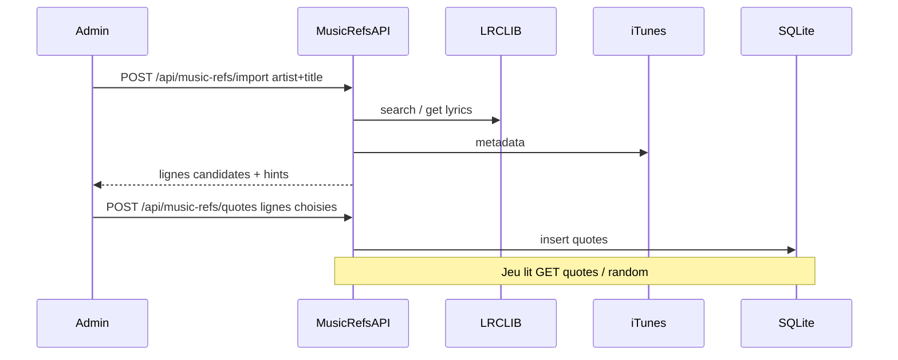

# API music-refs via lyrics libres (sans IA)

> Document de conception — archivé dans le dépôt.  
> Origine : plan Cursor `api_lyrics_sans_ia_10d7762d` (2026-09).  
> Statut : **implémenté** (voir [statut-implementation.md](statut-implementation.md)).

## Overview

Ajouter un backend FastAPI à music-refs qui importe des paroles via des APIs libres (LRCLIB + métadonnées iTunes/MusicBrainz), laisse choisir des punchlines, et sert le jeu depuis une base SQLite — sans LLM pour l’instant.

## Contexte

Aujourd’hui (avant cette feature) le jeu lisait un tableau figé dans `src/data/quotes.js`. Les tests et `404.html` annonçaient déjà une API (`/api/music-refs/quotes`, `/random`, `/health`, `/docs`) absente du repo. `nginx.conf` proxyait vers **8082**, déjà pris par **ADA** — conflit à corriger.

Sans IA : on ne peut pas partir d’une punchline seule (« le talent seul ne suffit pas ») pour retrouver Damso de façon fiable. Les APIs libres indexent **artiste + titre** (parfois album), pas le reverse-lyric. Le flux v1 = *je connais la chanson → je récupère les paroles → je choisis les punchlines*.

## Sources externes (sans clé)

| Rôle | API | Usage |
|---|---|---|
| Paroles | [LRCLIB](https://lrclib.net) `GET /api/search`, `GET /api/get` | Search + plain lyrics (User-Agent obligatoire) |
| Métadonnées (année, album, genre) | [iTunes Search API](https://itunes.apple.com/search) | Enrichissement hints ; fallback MusicBrainz si besoin |

## Flux cible

## Décisions figées

- **Port backend** : `8084` (libre ; 8082 reste ADA).
- **Stockage** : SQLite (`backend/data/quotes.db`), volume Docker ; seed initial depuis `quotes.js` au premier boot.
- **Auth admin** : header `X-Admin-Token` (secret dans `.env`) sur import / create / delete. Lecture publique pour le jeu.
- **Sélection punchlines** : l’humain choisit les lignes après import (pas d’auto-IA). Heuristique légère côté API : filtrer lignes trop courtes / metadata (`[Verse]`, credits).
- **IA** : hors scope ; endpoint d’enrichissement punchline→artiste reporté plus tard.

## Backend

Sous `backend/` (FastAPI + uvicorn) :

- `main.py` — app, CORS, `/health`, `/docs`, 404 JSON
- `providers/lrclib.py` — search + get lyrics
- `providers/itunes.py` — year / album / genre approx
- `providers/musicbrainz.py` — fallback métadonnées (ajout post-plan)
- `db.py` + modèle `Quote` (`id`, `quote`, `artist`, `title`, `hints{year,genre,album,initials}`)
- `routes/quotes.py` :
  - `GET /api/music-refs/quotes`
  - `GET /api/music-refs/random`
  - `POST /api/music-refs/import`
  - `POST /api/music-refs/quotes`
  - `DELETE /api/music-refs/quotes/{id}`

## Infra & frontend

- `docker-compose.yml` : service `music-refs-api` (8084), réseau `nginx-proxy-manager_default`, `restart: always`
- Proxy corrigé : `8082` → `8084` (nginx + registre infra + NPM)
- Frontend : `GameEngine` charge `GET /api/music-refs/quotes`, fallback `quotes.js`
- `admin.html` : import + catalogue (punchline / réponses)

## Preuves DoD

1. Ports documentés (`ss -tlnp`, README, CLAUDE.md, infra-reverse-proxy.md)
2. `.env` + `.gitignore` (token non commité)
3. `docker compose up -d --build` + health / quotes / import prouvés
4. README + docs procédures
5. NPM : `music-refs-dev.kladriva.ca` → `172.17.0.1:8084`

## Hors scope (plus tard)

- Reverse lookup punchline → artiste via LLM
- Agent ADA de chasse automatique
- Sync légale / copyright des paroles en prod publique (v1 = usage interne / QA)
