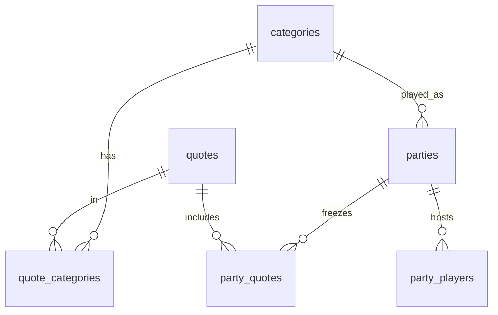

# Conception — Catégories & parties entre amis

> Livraison 2026-09-07 · Music Refs v1.2.0

## Objectif

1. **Catégories** : paniers nommés (Rap français, Slow, Musique chinoise, Artistes anglais…) contenant des titres / punchlines.
2. **Partie entre amis** : salon avec code, une catégorie, mêmes punchlines pour tous, classement final.

YouTube en arrière-plan : hors scope (plus tard).

## Modèle

## API

### Catégories
- `GET /api/music-refs/categories`
- `GET /api/music-refs/categories/{id}/quotes`
- `POST /api/music-refs/categories` (admin)
- `POST /api/music-refs/categories/{id}/quotes` `{ quote_ids: [] }` (admin)
- `DELETE /api/music-refs/categories/{id}` (admin)
- `GET /api/music-refs/quotes?category_id=`

### Parties
- `POST /api/music-refs/parties` `{ category_id, host_name, round_limit, mode? }`  
  `mode` = `classic` (saisie libre, défaut) | `easy` (quiz QCM artiste + titre)
- `POST /api/music-refs/parties/join` `{ code, player_name }`
- `GET /api/music-refs/parties/{code}` → expose `mode`
- `POST /api/music-refs/parties/{code}/start` `{ host_token }`
- `GET /api/music-refs/parties/{code}/quotes`
- `POST /api/music-refs/parties/{code}/score` `{ player_token, score, finished, progress? }`

## Modes de jeu

| Mode | Solo | Partie amis |
|---|---|---|
| **Normal** (`classic`) | Saisie libre artiste + titre | Idem, fixé par l’hôte |
| **Facile** (`easy`) | 4 propositions artiste + 4 titre (auto-valide dès les 2 choisis) | Même QCM pour tous (équité) |

## UI

| Page | Rôle |
|---|---|
| `/` | Solo + filtre catégorie + sélecteur Normal / Facile |
| `/party.html` | Créer (catégorie + mode) / rejoindre / jouer / classement live |
| `/admin.html` | Créer catégories, assigner punchlines |

## Seed contenu (2026-09-07)

Catégorie **Mbole** (rythme camerounais) + imports LRCLIB :

- Ref découverte : [YouTube — mbole](https://www.youtube.com/results?search_query=mbole)
- Artistes importés (selon dispo LRCLIB) : Locko, Blanche Bailly, Ko-C, Fanicko, Stanley Enow, Charlotte Dipanda…
- Aussi peuplé : Slow, Musique chinoise, densification Rap FR / Variété

Certaines recherches (Mink's, Magasco, Tenor…) échouent encore côté LRCLIB — à compléter plus tard ou par upload manuel.

## Catégorie Personnage public / influenceur

Hors musique : punchlines d’influenceurs (ex. Cameroun).

- Exemple seed : *« Quand une affaire arrive sur la toile j'ai le devoir de commenter... »* → **Aicha Kamoise** / *Devoir de commenter*
- À enrichir au fil de l’eau via `/admin.html` (artiste = nom de l’influenceur, titre = nom du moment / catchphrase)
