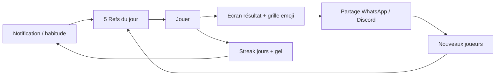

# Conception — Refs du jour & rétention

> Backlog : [`BACKLOG.md`](../../BACKLOG.md) · volet RET-*  
> Sources d’inspiration : Wordle (rareté + share), Duolingo (streak jours), TikTok (récompense variable), SongPop (défi asynchrone), PG *Do Things that Don't Scale*.

## Thèse

Music Refs a un **catalogue** (milliers de punchlines) mais pas encore de **boucle**.  
La traction ne viendra pas de plus de contenu ni d’une autre charte : elle viendra d’un **rendez-vous quotidien** et d’un **artefact partageable** sans spoiler.

> « 1232 citations, c’est un catalogue. 5 par jour, c’est un rituel. »  
> « Ce n’est pas le contenu qui retient, c’est le rendez-vous. »

## Boucle cible (MVP)



1. **Rareté** : 5 refs / jour / catégorie (mêmes pour tous, seed `date|category_id`).  
2. **Share** : grille emoji + score (ex. 4/5 sans indice), lien, **sans** spoiler.  
3. **Streak** : jours consécutifs (≠ combo intra-partie).  
4. **Infini** : reste, mais CTA secondaire.

## API (esquisse)

```
GET /api/music-refs/daily?category_id=&date=YYYY-MM-DD
→ { day_number, date, category, quotes: [{ id, quote, rarity? }] }  // sans artist/title si SEC-01

POST /api/music-refs/daily/complete
→ { grid, score_summary, share_text }  // après SEC-02
```

Seed déterministe serveur (ex. hash(date + category) → shuffle stable du pool).

## Share (exemple)

```
Music Refs #112 · Rap FR
🎤 🟩🟩🟨⬛🟩
4/5 · sans indice
🔥 série 12
https://music-refs-dev.kladriva.ca/?daily=1
```

## Ordre d’implémentation

1. **Humains** — [`HUM-01`](../../BACKLOG.md) : poster 5 refs / jour dans 3 WhatsApp pendant 14 j (hors agents).  
2. **Humains** — HUM-03 go/no-go.  
3. **Agents / code** — RET-01 → RET-02, puis RET-03…  

Ne pas lancer le build daily tant que HUM-01 n’a pas donné un signal (sauf spike explicite).

## Hors scope immédiat

- Compte obligatoire  
- Pub / push natif (mobile plus tard)  
- Remplacer le mode party sync (compléter par défi asynchrone RET-06)
